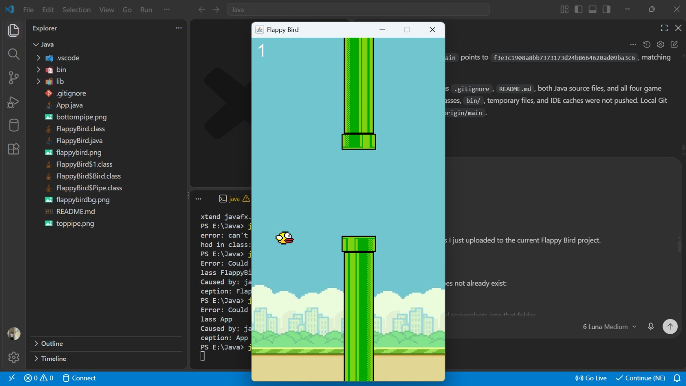
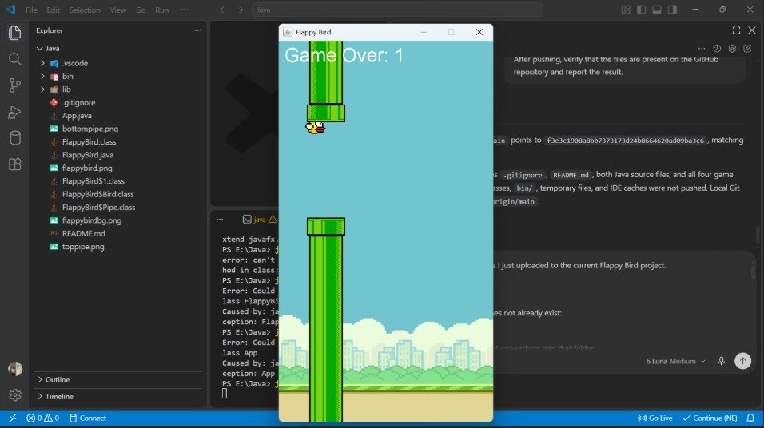

<div align="center">
<samp><b>FLAPPY BIRD</b></samp>

<samp>java · swing · awt · game development</samp>

</div>

---

<div align="center"><samp>A lightweight Flappy Bird-style desktop game built in Java using Swing and AWT, with keyboard-controlled flight, scrolling pipes, collision detection, and score tracking.</samp></div>

---

<div align="center"><samp><b>Features</b></samp></div>

- <samp><b>Side-scrolling gameplay</b> — pipe pairs move continuously from right to left with randomized gaps.</samp>
- <samp><b>Physics-based movement</b> — gravity controls the bird's downward velocity while Space applies an upward flap.</samp>
- <samp><b>Collision detection</b> — detects collisions with pipes and the lower play boundary.</samp>
- <samp><b>Score tracking</b> — passing a pipe pair increases the score.</samp>
- <samp><b>Restart support</b> — press Space after game over to reset the round.</samp>

---

<div align="center"><samp><b>Gameplay</b></samp></div>

<samp>The bird continuously falls under gravity. Press <b>Space</b> to flap upward and navigate through the gaps between moving pipe pairs. The round ends when the bird hits a pipe or falls below the play area.</samp>

---

<div align="center"><samp><b>Controls</b></samp></div>

| <samp>Key</samp> | <samp>Action</samp> |
|---|---|
| <samp>Space</samp> | <samp>Flap upward</samp> |
| <samp>Space after game over</samp> | <samp>Restart the game</samp> |

---

<div align="center"><samp><b>Screenshots</b></samp></div>

<div align="center">



*Gameplay with a score of 1.*



*Game over with a score of 1.*

</div>

---

<div align="center"><samp><b>Requirements</b></samp></div>

- <samp>JDK 8 or newer</samp>
- <samp>No external Java libraries</samp>

<samp>The project uses standard Java Swing and AWT APIs.</samp>

---

<div align="center"><samp><b>Run</b></samp></div>

<samp>Compile the Java source files from the project root:</samp>

```bash
javac -d bin App.java FlappyBird.java
```

<samp>Run the application:</samp>

```bash
java -cp "bin;." App
```

<samp>On macOS or Linux, use <code>:</code> instead of <code>;</code> in the classpath:</samp>

```bash
java -cp "bin:." App
```

<samp>The project root is included in the classpath so the game can load its PNG resources.</samp>

---

<div align="center"><samp><b>Project Structure</b></samp></div>

```text
Flappy-bird/
├── App.java            Creates and displays the Swing window
├── FlappyBird.java     Game logic, rendering, physics, input, scoring
├── flappybird.png      Bird sprite
├── flappybirdbg.png    Background image
├── toppipe.png         Upper pipe sprite
├── bottompipe.png      Lower pipe sprite
├── .gitignore          Ignore rules
└── README.md           Project documentation
```

---

<div align="center"><samp><b>Game Mechanics</b></samp></div>

- <samp><b>Gravity:</b> increases the bird's downward velocity each frame.</samp>
- <samp><b>Flap:</b> Space sets the bird's vertical velocity upward.</samp>
- <samp><b>Pipe spawning:</b> pipe pairs spawn every 1.5 seconds with a randomized vertical position and fixed gap.</samp>
- <samp><b>Pipe movement:</b> pipes scroll from right to left across the screen.</samp>
- <samp><b>Scoring:</b> passing each pipe contributes half a point, producing one point per pipe pair.</samp>
- <samp><b>Game over:</b> occurs on pipe collision or when the bird falls below the board.</samp>

---

<div align="center"><samp><b>Technologies</b></samp></div>

| <samp>Technology</samp> | <samp>Purpose</samp> |
|---|---|
| <samp>Java</samp> | <samp>Application and game logic</samp> |
| <samp>Swing</samp> | <samp>Desktop window and rendering surface</samp> |
| <samp>AWT</samp> | <samp>Graphics and keyboard input</samp> |

---

<div align="center"><samp><b>Future Improvements</b></samp></div>

- <samp>Add a title screen and pause option.</samp>
- <samp>Add sound effects and persistent high scores.</samp>
- <samp>Remove pipes after they leave the play area.</samp>

---

<div align="center"><samp><b>Author</b></samp></div>

<div align="center">
<samp><strong>Yoson</strong></samp>

<samp>Java, game development, AI/ML, robotics, and embedded systems.</samp>
</div>
